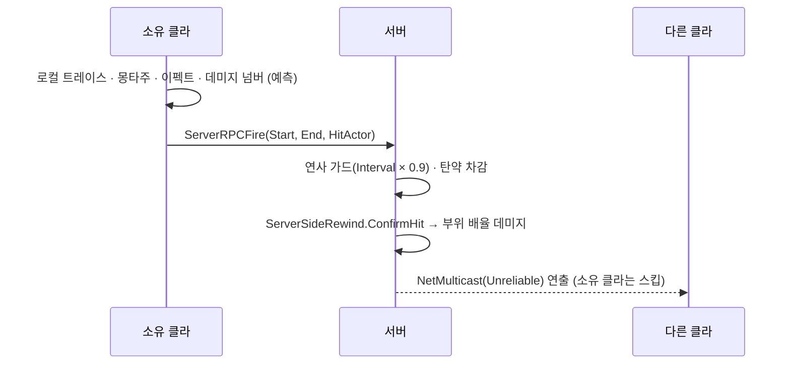
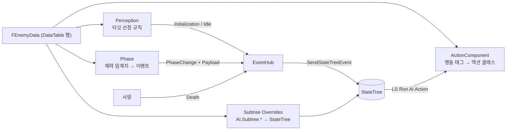
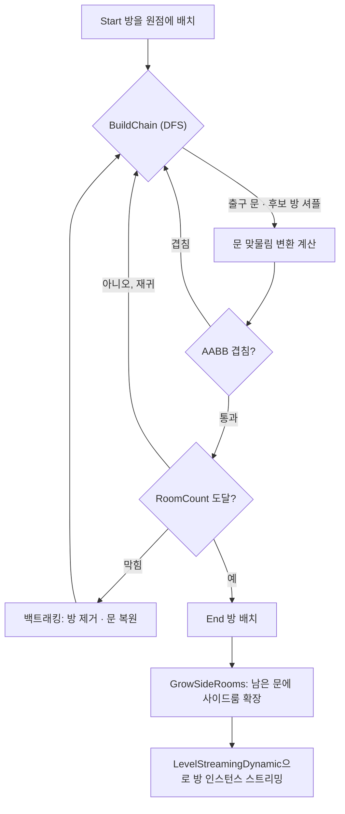

# LastStand

언리얼 엔진 5(소스 빌드)와 C++로 만든 **서버 권위(Server-Authoritative) 멀티플레이 3인칭 슈터**입니다.
개인 프로젝트이고 기간은 2026.04부터 현재까지입니다. 게임플레이, 네트워크, AI, 에디터 툴의 C++ 구현을 모두 직접 했습니다.

<!-- 대표 GIF: 데디케이트 서버 + 클라 2명이 보스와 교전하는 장면 -->

| 핵심 기능 | 한 줄 요약 |
|---|---|
| [1. 네트워크 전투: 예측과 랙 보상](#1-서버-권위-네트워크-전투--클라-예측과-랙-보상) | 클라이언트는 쏘는 즉시 반응하고, 서버는 쏜 사람의 핑만큼 히트박스를 되감아 다시 판정합니다. 달리기와 대시는 CMC SavedMove로 예측합니다. |
| [2. 데이터 드리븐 보스 AI](#2-데이터-드리븐-멀티플레이-보스-ai-statetree) | 행동은 StateTree에, 몬스터별 차이는 DataTable 한 행에 둡니다. 판단은 서버만 하고 결과만 복제합니다. |
| [3. 절차적 던전 생성 플러그인](#3-절차적-던전-생성-플러그인-mapgenerator) | 방 서브레벨의 문을 맞물려 이어 붙이는 시드 기반 생성기입니다. 백트래킹 DFS로 배치하고 독립 플러그인으로 분리했습니다. |

**기술 스택**: UE5(소스 빌드) · C++ · Dedicated Server · StateTree · Enhanced Input · GameplayTags · Niagara · UMG

---

## 1. 서버 권위 네트워크 전투 — 클라 예측과 랙 보상

> 반응성은 클라이언트가 맡고, 판정 권한은 서버가 가집니다. 핑이 있어도 "내 화면에서 맞았는데 안 맞음" 현상이 생기지 않게 하는 것이 목표였습니다.

### 1-1. 히트스캔 발사 파이프라인



- 클라이언트는 발사 시각을 보내지 않고 **트레이스 구간과 맞힌 대상만** 신고합니다. 판정에 쓸 시간은 서버가 정합니다.
- 연출 멀티캐스트는 `Unreliable`로 보냅니다. 이미 로컬에서 재생한 소유 클라이언트는 `IsLocallyControlled()`로 걸러 중복 재생을 막습니다.
- 히트스캔 전용 트레이스 채널을 만들고 Pawn 콜리전 프로파일에서는 Ignore로 설정했습니다. 그래서 캡슐이 아닌 **부위별 히트박스**(Head 2.0 / WeakPoint 3.0 / 사지 0.7)에만 맞습니다.

### 1-2. 서버사이드 리와인드 (Lag Compensation)

- 서버에서만 틱이 돌면서 **20ms마다** 모든 히트박스의 위치·회전·크기를 스냅샷으로 남기고 **200ms**까지 보관합니다.
- 피격을 확인할 때는 쏜 사람의 RTT만큼 과거 시점을 계산합니다. 그 시점 앞뒤 스냅샷을 `Lerp`/`Slerp`로 보간한 뒤 **세그먼트-OBB 교차**를 검사합니다. 세그먼트를 박스 로컬 공간으로 옮겨 AABB 검사로 바꾸는 방식입니다.
- 히트박스는 `ILSHitboxInterface`로 수집합니다. 그래서 **플레이어와 적이 같은 코드 경로**를 씁니다.

```cpp
// (요약) 쏜 사람의 RTT(서버가 패킷 ACK로 측정)만큼 되감기 — 클라 값은 신뢰하지 않음, 200ms 상한
float RewindTime = Shooter->GetPlayerState()->GetPingInMilliseconds() * 0.001f;
const float QueryTime = Now - FMath::Clamp(RewindTime, 0.0f, HistoryEndOffset);

// QueryTime을 감싸는 두 스냅샷을 보간해 판정
Alpha = (QueryTime - Before->Time) / (After->Time - Before->Time);
const FHitBoxSnapshot Box = InterpolateBox(Pair.Value, *BoxB, Alpha);
if (SegmentIntersectsBox(Box, TraceStart, TraceEnd)) { /* 라이브 히트박스 반환 */ }
```

### 1-3. CMC 이동 예측 — 달리기 / 대시

`UCharacterMovementComponent`를 상속해 달리기와 대시를 **엔진의 예측·보정 파이프라인 안에서** 처리했습니다. RPC로 따로 보내지 않습니다.

- `FSavedMove_LS`에 `bWantsToRun`/`bWantsToDash`를 저장합니다. 이 값은 `FLAG_Custom_0/1` 압축 플래그로 서버에 가고, 서버는 `UpdateFromCompressedFlags`로 상태를 복원합니다.
- 대시는 `FRootMotionSource_ConstantForce`로 구현해서 서버 보정과 리플레이 대상에 포함됩니다.
- `CanCombineWith`에서 대시 요청이 담긴 move는 병합하지 않습니다. 병합되면 대시 요청이 사라지기 때문입니다.
- 서버 쿨다운 검사에는 연사 가드와 같은 `0.9` 허용오차를 둡니다.

### 설계 결정 · 트러블슈팅

| 문제 | 원인 | 해결 |
|---|---|---|
| 클라가 보낸 발사 시각을 조작하면 과거로 무한히 되감을 수 있음 | 판정 시간을 클라이언트가 결정함 | `PlayerState`의 **서버 측정 핑**으로 되감기 시간을 정하고 200ms로 클램프 |
| 보정(리플레이) 직후 달리기/대시 입력이 씹힘 | `ClientUpdatePositionAfterServerUpdate` 중 `PrepMoveFor`가 과거 move 값으로 현재 입력을 덮어씀 | 리플레이 전후로 현재 프레임 입력을 저장했다가 복원. 리플레이 중에는 대시를 다시 적용하지 않음(`bClientUpdating`) |
| 데디 서버에서 히트박스가 실제 메시와 어긋남 | 렌더링이 없는 서버에서는 본 갱신을 건너뜀 | `AlwaysTickPoseAndRefreshBones`로 서버에서도 포즈 갱신 |

관련 코드: [LSWeaponHitscan.h](Source/LastStand/Item/Equipment/Weapon/LSWeaponHitscan.h) · [.cpp](Source/LastStand/Item/Equipment/Weapon/LSWeaponHitscan.cpp), [LSServerSideRewindComponent.h](Source/LastStand/Character/Components/LSServerSideRewindComponent.h) · [.cpp](Source/LastStand/Character/Components/LSServerSideRewindComponent.cpp), [LSHitboxComponent.h](Source/LastStand/Character/Components/LSHitboxComponent.h) · [.cpp](Source/LastStand/Character/Components/LSHitboxComponent.cpp), [LSCharacterMovementComponent.h](Source/LastStand/Character/Components/LSCharacterMovementComponent.h) · [.cpp](Source/LastStand/Character/Components/LSCharacterMovementComponent.cpp)

---

## 2. 데이터 드리븐 멀티플레이 보스 AI (StateTree)

> 여러 플레이어가 함께 상대하는 보스입니다. **판단은 서버에서만 하고**, 몬스터마다 다른 점(행동·서브트리·어그로 규칙·페이즈)은 **`FEnemyData` 한 행**으로 바꿀 수 있게 설계했습니다.

<!-- 보스 교전 GIF: 페이즈 전환 · 근접 스윕 · 산탄 히트스캔 디버그 -->



### 이벤트 허브 — StateTree 이벤트 통로를 하나로
- 퍼셉션·체력·사망 등 여러 곳에서 오는 이벤트를 `ULSAIEventHubComponent::SendEvent` 하나로 모았습니다. **`AI.Event` 하위 태그만** 받습니다.
- AI 컨트롤러의 possess가 `BeginPlay`보다 늦을 수 있습니다. 그래서 StateTree 컴포넌트는 처음 필요할 때 찾아서 캐시합니다.

### 액션 시스템 — 행동을 데이터로 조립
- `UObject` 기반 `ULSAIActionBase`가 쿨다운·사거리·몽타주를 공통으로 처리합니다. 파생 클래스는 **MeleeSweep**(AnimNotify 히트 윈도우 동안 소켓 궤적을 구체 스윕, 같은 대상은 한 번만 피격), **Hitscan**(원뿔 안 산탄 펠릿), **PlayMontage**입니다.
- 파라미터 프리셋은 BP 서브클래스 기본값으로 만듭니다. `FEnemyData::Actions`(행동 태그 → 클래스)를 보고 **적마다 인스턴스를 생성**하므로 쿨다운 같은 런타임 상태가 적끼리 섞이지 않습니다.
- StateTree 쪽은 `LS Run AI Action` Task와 `LS Can Run AI Action` Condition 두 개만 쓰면 됩니다.

```cpp
// (요약) 행동 종료 → Task 완료 (약참조 실행 컨텍스트로 비동기 FinishTask)
InstanceData.FinishedHandle = InstanceData.ActionComp->OnActionFinished.AddLambda(
    [WeakContext = Context.MakeWeakExecutionContext(), ActionTag = InstanceData.ActionTag](FGameplayTag FinishedTag, bool bSucceeded)
    {
        if (FinishedTag == ActionTag)
        {
            WeakContext.FinishTask(bSucceeded ? EStateTreeFinishTaskType::Succeeded : EStateTreeFinishTaskType::Failed);
        }
    });
// ExitState: 구독을 먼저 해제한 뒤 실행 중인 행동을 취소 → 피격·사망 전이 시 깔끔하게 중단
```

### 몬스터별 서브트리 교체
- Base StateTree의 Linked Asset 상태에 `AI.Subtree.*` 슬롯 태그를 붙여 둡니다. `FEnemyData::SubtreeOverrides`에 지정한 트리로 `SetLinkedStateTreeOverrides` 교체합니다.
- 스키마 검증이 설정된 트리를 기준으로 하기 때문에 **`SetStateTree` → 오버라이드 적용 → `StartLogic`** 순서로 호출합니다.

### 타깃 선정 · 어그로
- 서버 전용 캡슐 감지입니다. 선정 방식은 데이터로 고릅니다: `Closest` / `TopDamage`(`ULSStatComponent`가 공격자별 누적 데미지 기록) / `Random` / `RandomLocked`. `TargetChangeDelay` 동안은 타깃을 바꾸지 않아 떨림을 막고, 타깃이 파괴되거나 범위를 벗어나면 딜레이와 상관없이 즉시 다시 고릅니다.
- 처음 감지하면 감지 범위를 **어그로 범위로 넓혀** 경계에서 어그로가 켜졌다 꺼졌다 하는 것을 막습니다. 감지 대상이 없는 상태가 이어지면 어그로를 해제하고 범위를 되돌린 뒤 `Idle` 이벤트를 보냅니다.

### 페이즈 전환
- 체력 비율 임계치를 내림차순으로 정렬해 둡니다. 한 번의 피격으로 여러 임계치를 넘으면 **가장 낮은 것 하나만** 발동하고 나머지는 소비 처리합니다. 결과는 복제 변수 `CurrentPhase`와 이벤트 Payload(`FLSPhaseChangePayload`)로 전달합니다.

### 네트워크 처리
- AI 컨트롤러는 서버에만 있습니다. 그래서 **컨트롤 회전을 서버 Tick에서 복제**하고, 이 값으로 클라이언트 애님 인스턴스가 에임 오프셋을 계산합니다.
- 몸 Yaw는 `RInterpTo`로 컨트롤 Yaw를 늦게 따라갑니다. 차이가 60° 이상이면 서버가 턴 플래그를 계산해 복제합니다. 몽타주가 재생되는 동안에는 회전을 잠급니다.
- 액션 몽타주와 판정 디버그 드로우는 액션 컴포넌트의 `NetMulticast`로 모든 머신에 보냅니다.

관련 코드: [LSAIEventHubComponent.cpp](Source/LastStand/AI/Components/LSAIEventHubComponent.cpp), [LSAIActionComponent.cpp](Source/LastStand/AI/Components/LSAIActionComponent.cpp), [LSAIActionBase.h](Source/LastStand/AI/Action/LSAIActionBase.h), [LSAIAction_MeleeSweep.cpp](Source/LastStand/AI/Action/LSAIAction_MeleeSweep.cpp), [LSAIAction_Hitscan.cpp](Source/LastStand/AI/Action/LSAIAction_Hitscan.cpp), [LSStateTreeRunAIActionTask.cpp](Source/LastStand/AI/StateTree/LSStateTreeRunAIActionTask.cpp), [LSAIController.cpp](Source/LastStand/AI/LSAIController.cpp), [LSAIPerceptionComponent.cpp](Source/LastStand/AI/Components/LSAIPerceptionComponent.cpp), [LSEnemyBase.cpp](Source/LastStand/AI/LSEnemyBase.cpp), [LSEnemyData.h](Source/LastStand/DataTable/LSEnemyData.h)

---

## 3. 절차적 던전 생성 플러그인 (MapGenerator)

> 방 서브레벨을 **문끼리 맞물려** 이어 붙이는 시드 기반 생성기입니다. 게임 모듈과 분리된 Runtime / Editor 플러그인으로 만들었습니다.

<!-- 생성 GIF: 시드 변경 → 체인 생성 → 사이드룸 확장 → 스트리밍 -->



- **백트래킹 DFS** (`BuildChain`): 열려 있는 출구 문과 후보 방을 Fisher–Yates로 섞어서 차례로 시도합니다. 놓을 수 있으면 재귀로 내려가고, 막히면 방을 빼고 문을 되돌린 뒤 다음 후보를 시도합니다. `FRandomStream(Seed)`를 쓰므로 **같은 시드면 항상 같은 던전**이 나옵니다.
- **사이드룸 확장** (`GrowSideRooms`): 메인 체인을 다 만든 뒤 남은 문에 `SideRoomDepth`번 패스를 돌며 곁방을 붙입니다. 끝방은 확장 대상에서 뺍니다.
- **충돌 회피** (`CanPlaceRoom`): 방 경계 박스를 배치 트랜스폼으로 옮겨 world AABB를 만들고 기존 방과 겹치는지 검사합니다. 벽을 공유하는 접촉은 Epsilon으로 허용합니다.

```cpp
// 자식 입구 문이 부모 출구의 반대 방향을 향하도록 90° 단위로 회전하고, 두 문 위치를 일치시킴
const float ChildYaw = YawOfDir(OppositeDir(PWorldDir)) - YawOfDir(CDoor.Direction);
const FRotator Rot(0.f, ChildYaw, 0.f);
const FVector  T = PWorldPos - Rot.RotateVector(CDoor.Location);
return FTransform(Rot.Quaternion(), T);

// 90° 회전된 방의 AABB: Extent를 회전 후 절댓값 → X/Y 스왑이 자동 처리
const FVector WExtent = Rot.RotateVector(Box.Extent).GetAbs();
```

### 에디터 툴링
- 레벨 디자이너는 방 레벨에 `ABoxVolume`(경계)과 `ADoorVolume`(입구·출구)만 배치하면 됩니다. DataTable 우클릭 메뉴를 실행하면 각 방 레벨을 열어 바운즈와 문 정보를 행으로 **export**합니다. 입구가 정확히 1개인지도 이때 검증합니다.
- 처음에는 `UDeveloperSettings`의 `CallInEditor` 버튼을 쓰려 했습니다. 그런데 편집 대상이 CDO라서 버튼이 실행되지 않는 엔진 제약이 있었습니다. 그래서 Editor 모듈에서 **에셋 컨텍스트 메뉴로 우회**했습니다.
- `AMapGenerator` 액터에 생성 파라미터 데이터 에셋(테이블·방 개수·시드·사이드룸 깊이)을 지정하고 Generate / Clear 버튼으로 미리 봅니다.

관련 코드: [MapGeneratorSubsystem.h](Plugins/MapGenerator/Source/MapGenerator/Public/MapGeneratorSubsystem.h) · [.cpp](Plugins/MapGenerator/Source/MapGenerator/Private/MapGeneratorSubsystem.cpp), [MapData.h](Plugins/MapGenerator/Source/MapGenerator/Public/MapData.h), [DoorVolume.h](Plugins/MapGenerator/Source/MapGenerator/Public/DoorVolume.h), [BoxVolume.h](Plugins/MapGenerator/Source/MapGenerator/Public/BoxVolume.h), [MapGeneratorActor.h](Plugins/MapGenerator/Source/MapGenerator/Public/MapGeneratorActor.h), [MapGeneratorEditor.cpp](Plugins/MapGenerator/Source/MapGeneratorEditor/Private/MapGeneratorEditor.cpp)

---

## 그 밖의 구현

- **태그 기반 액션 상태**: 대시·장전·장착 상태를 GameplayTag로 모읍니다. `ActionRules`(BlockedBy / Cancel)로 입력을 막거나 진행 중인 상태를 취소합니다(예: 대시하면 장전 취소). 규칙은 BP에서 설정합니다. → [LSActionStateComponent.cpp](Source/LastStand/Character/Components/LSActionStateComponent.cpp)
- **인벤토리 / 장비**: `FFastArraySerializer` 델타 인벤토리를 씁니다. 장비 맵은 TMap을 직접 복제할 수 없어 배열로 복제한 뒤 클라이언트에서 다시 구성합니다. 무기를 해제하면 탄창의 탄약을 인벤토리로 돌려주고, `EndPlay`에서 넷 롤별로 정리합니다. → [LSInventoryComponent.cpp](Source/LastStand/Character/Components/LSInventoryComponent.cpp), [LSEquipmentComponent.cpp](Source/LastStand/Character/Components/LSEquipmentComponent.cpp)
- **무기 연출**: 무기별 애님 레이어 링크(`LinkAnimClassLayers`), `FTimeline` 기반 ADS 줌, `EWeaponMontageType` 몽타주 디스패치를 구현했습니다. 발사·장전 AnimNotify에서 사운드와 Niagara를 재생합니다. → [LSWeaponBase.cpp](Source/LastStand/Item/Equipment/Weapon/LSWeaponBase.cpp)
- **UI**: `ULSUISubsystem`이 GameplayTag 키로 레이어/슬롯을 관리하고, 아직 등록되지 않은 슬롯은 지연 주입합니다. `ULSUIEventSubsystem` 이벤트 버스로 게임플레이와 HUD를 분리했습니다. 데미지 넘버는 오브젝트 풀링을 씁니다. → [LSUISubsystem.cpp](Source/LastStand/UI/LSUISubsystem.cpp), [LSUIEventSubsystem.h](Source/LastStand/UI/LSUIEventSubsystem.h)
- **데이터 드리븐 코어**: `UDeveloperSettings` → `ULSDataSubsystem` → DataTable 행 순서로 조회합니다. 에셋은 하드 레퍼런스 없이 `TSoftObjectPtr`/`TSoftClassPtr`로 들고 있다가 사용 시점에 로드합니다. → [LSDataSubsystem.h](Source/LastStand/DataTable/LSDataSubsystem.h)
- **인터페이스 기반 컴포넌트 설계**: Stat / Hitbox / Inventory / Interact / Interactable / ActionState / AIEventHub / AIAction 인터페이스를 둬서, 공통 베이스 클래스 없이도 공용 시스템이 플레이어와 적을 같은 경로로 처리합니다. → [Interface/](Source/LastStand/Interface)
- **테스트 환경**: 패키지 빌드한 데디케이트 서버와 클라이언트를 실행하는 스크립트(`RunServer.ps1` / `RunClient.ps1`)로 실제 네트워크 환경에서 검증했습니다.

## 리플리케이션 패턴

| 패턴 | 용도 | 예시 |
|---|---|---|
| `ReplicatedUsing = OnRep_X` | 상태 전파와 클라이언트 후처리. 서버에서는 OnRep이 호출되지 않아 직접 브로드캐스트 | `CurrentHealth`, `CurrentAmmo` |
| `COND_SkipOwner` | 소유 클라이언트가 이미 예측한 상태를 되돌리지 않음 | `bIsAim` |
| SavedMove 압축 플래그 | 이동 상태를 CMC 예측·보정에 포함 | 달리기 / 대시 |
| `Reliable` Server RPC | 상태 전환(엣지 트리거). 패킷이 빠져도 상태가 고착되지 않게 함 | `ServerRPCAim`, `ServerRPCReload` |
| `Unreliable` NetMulticast | 고빈도 연출. 소유 클라이언트는 스킵 | `MulticastRPCPlayFireEffects` |
| 서버 계산 → 복제 | 서버에만 있는 AI 판단 결과를 클라이언트 애님에 전달 | `CurrentControllerRotation`, `bTurnLeft/Right`, `CurrentPhase` |
| `FFastArraySerializer` | 배열 델타 복제 | `FInventoryItemInfoArray` |

## 프로젝트 구조

```
LastStand/
├─ Source/LastStand/
│  ├─ Character/            플레이어·베이스 캐릭터
│  │  └─ Components/        Stat / Equipment / Inventory / Interaction / Hitbox
│  │                        ServerSideRewind / CharacterMovement / ActionState
│  ├─ AI/                   EnemyBase · AIController
│  │  ├─ Action/            ActionBase · MeleeSweep · Hitscan · PlayMontage
│  │  ├─ Components/        EventHub · Action · Perception
│  │  └─ StateTree/         CombatGlobalTask · RunAIAction · CanRunAIAction · SetMoveSpeed · JumpToLocation
│  ├─ Item/Equipment/Weapon/  장비·무기 베이스, 히트스캔 무기
│  ├─ UI/                   UISubsystem · 이벤트 버스 · Widget/ · Operation/
│  ├─ Animation/            플레이어 / AI 애님 인스턴스, 무기·AI 액션 노티파이
│  ├─ DataTable/ Data/ Settings/   데이터 서브시스템 · 행 구조체 · 데이터 애셋 · 설정
│  ├─ Interface/ Tags/      컴포넌트 인터페이스 · 네이티브 GameplayTag
│  └─ Player/ GameState/ Gamemode/ Props/ Save/
└─ Plugins/MapGenerator/    절차적 던전 생성 (Runtime + Editor 모듈)
```

## 개발 환경

- 엔진: 언리얼 엔진 5 소스 빌드
- 모듈 의존성: Core / CoreUObject / Engine / InputCore / EnhancedInput / UMG / GameplayTags / NetCore / Slate / SlateCore / AIModule / GameplayTasks / StateTreeModule / GameplayStateTreeModule / Niagara / MapGenerator, (Private) OnlineSubsystem
- 코드 주석: 한국어
